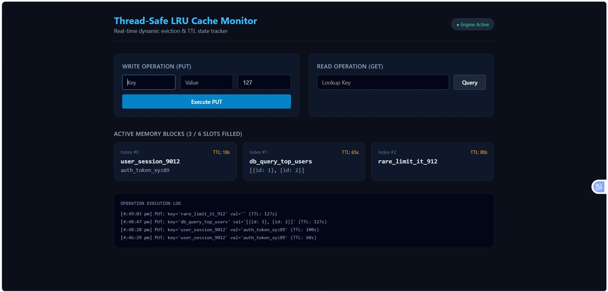

# Thread-Safe LRU Cache Engine & Real-Time Visualizer

A high-performance $O(1)$ time complexity Least Recently Used (LRU) cache implementation, featuring a custom REST API and a real-time React monitoring dashboard. 

The core engine combines a hash map with a doubly linked list, utilizing Python threading locks to ensure zero data corruption during highly concurrent operations, alongside a dynamic Time-To-Live (TTL) eviction policy.




## System Architecture
* **Core Engine:** Pure Python implementation using a doubly linked list and hash map for $O(1)$ `get` and `put` operations.
* **Concurrency & Memory Management:** Thread-safe execution using `threading.Lock()` to prevent race conditions. Automatic TTL-based eviction for stale nodes.
* **API Bridge:** A FastAPI REST interface that exposes the cache to external web clients.
* **Frontend Visualizer:** A React + Vite dashboard styled with Tailwind CSS, polling the API to visualize memory blocks, cache hits/misses, and live countdowns.

## Tech Stack
* **Backend:** Python, FastAPI, Uvicorn, Pytest
* **Frontend:** React, Vite, Tailwind CSS
* **Concepts:** Data Structures, Concurrency Control, Microservices, API Polling

## How to Run Locally

### 1. Start the Backend API
Open a terminal in the root directory and run:
```bash
pip install fastapi uvicorn pydantic
python -m uvicorn api:app --reload --port 8000